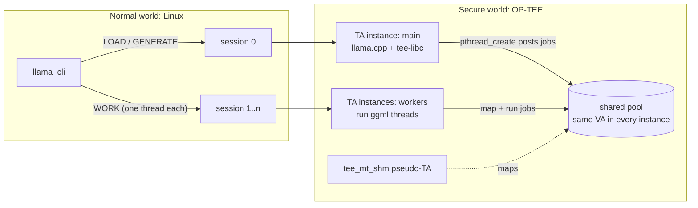

# optee-llm

Run llama.cpp — unmodified — inside an OP-TEE Trusted Application, on several CPU cores.

The model's weights, the prompt and the generated text stay in TrustZone secure memory; the normal
world (Linux) only relays the bytes the client chooses to send. The repository has two
parts that are useful on their own:

- **tee-libc** — a C and C++ runtime for OP-TEE TAs: musl 1.2.5 plus Alpine's libstdc++ 14, with
  exceptions, RTTI, the STL, iostreams, `std::regex`, `std::mutex`, static constructors, an
  in-memory file system (`open`/`read`/`mmap` on buffers you register) and a fast allocator
  (musl's mallocng). Most C/C++ libraries that only need a CPU build against it unchanged.
- **Threads across TA instances** — an OP-TEE TA instance runs one thread. tee-libc's `tee_mt`
  gives a TA real `pthread_create`/`pthread_join` by running the threads in other instances of the
  same TA, which share one pool of secure memory mapped at the same address (a small pseudo-TA in
  the OP-TEE core). ggml's thread pool runs on it as is.

`examples/llama` puts both together: a TA that loads a GGUF model sent from Linux and generates
text with llama.cpp, plus a Linux reference program built from the same engine source so you can
check that the TA produces the same tokens.

## How it works



- The client opens one session to load the model and generate, and one more session per extra
  core. Those sessions call `TA_LLAMA_CMD_WORK` and wait in the TA for jobs.
- The main instance asks the `tee_mt_shm` pseudo-TA for a pool of secure memory; workers map the
  same pool at the same virtual address. From then on, every `malloc` of the main instance comes
  from the pool, so any pointer llama.cpp creates means the same thing in every instance.
- `pthread_create` posts the thread function (shifted by the instance's load offset) to a waiting
  worker. Computations run on a stack in the pool, because ggml keeps the compute plan in the
  caller's stack frame.
- The model file is uploaded in chunks into a page-aligned buffer and registered as
  `/tee/model.gguf`; llama.cpp's `mmap` of it returns the buffer itself, so the weights exist once.

## What is in the repository

| Path | What |
| --- | --- |
| `tee-libc/fetch.sh` | Downloads musl and Alpine's `libstdc++-dev` (pinned SHA-256) |
| `tee-libc/build-musl.sh` | Builds musl for TAs: system calls go to the shim, one static thread |
| `tee-libc/make-devkit.sh` | Copies your OP-TEE TA dev kit with the fixes C++ TAs need (see below) |
| `tee-libc/flags.mk`, `toolchain.cmake` | Compiler and link flags, for Make and for CMake projects |
| `tee-libc/shim/` | TA-side code: system calls, unwinder, in-memory files, threads |
| `optee/pta/` | `tee_mt_shm`, the pseudo-TA behind the shared pool |
| `optee/patches/condemn.patch` | Ends worker instances left spinning when one sharing the pool dies |
| `optee/patches/user-va-slots.patch` | Optional: more than 1 GiB of address space per TA (LPAE) |
| `examples/cxx-probe` | A TA that checks the C++ runtime (static init, STL, exceptions, mutex, streams, regex) |
| `examples/llama` | llama.cpp text generation in a TA, its client and the Linux reference |

## Requirements

- An AArch64 board running OP-TEE (developed on optee_os 4.11.0) with `optee_client`
  (`libteec`, `tee-supplicant`), and enough TZDRAM for your model: roughly the GGUF size plus
  100–200 MiB for a 1B model. Most platforms reserve far less by default; set `CFG_TZDRAM_SIZE`
  (and the matching reserved-memory node for Linux) accordingly.
- An AArch64 Linux build host with GCC, GNU make, CMake ≥ 3.14, curl and `sha256sum`. The board
  itself works; so does any arm64 machine or VM. The build uses the host's GCC with musl's and
  Alpine's headers, and links the host's `libgcc_eh.a`.
- The OP-TEE TA dev kit for your platform (`out/<platform>/export-ta_arm64` from your optee_os
  build).

Tested on a Rockchip RK3576 (4× Cortex-A72 + 4× Cortex-A53) with optee_os 4.11.0: the probe
passes, and Llama 3.2 1B Instruct (Q4_0) in the TA, on 1 and on 4 cores, generates the same tokens
as `engine/ref` on Linux.

## Build

### 1. OP-TEE

```sh
optee/install.sh <optee_os>              # add --va-slots for more than 1 GiB per TA
make -C <optee_os> PLATFORM=<your platform> ... \
    CFG_NUM_THREADS=8 CFG_CORE_HEAP_SIZE=524288 CFG_TZDRAM_SIZE=<enough for the model>
```

- `CFG_NUM_THREADS`: at least the number of TA instances that run at once (one per core you use,
  plus one).
- `CFG_CORE_HEAP_SIZE`: the default 64 KiB core heap runs out of page-table bookkeeping when a TA
  maps close to 1 GiB.
- With `--va-slots`, also set `CFG_USER_VA_SLOTS=<GiB per TA>` and `CFG_LPAE_ADDR_SPACE_BITS=36`.

Flash it the way your platform boots OP-TEE.

### 2. tee-libc

```sh
tee-libc/fetch.sh
tee-libc/build-musl.sh
tee-libc/make-devkit.sh <optee_os>/out/<platform>/export-ta_arm64
```

Everything goes to `build/` (or `$OPTEE_LLM_BUILD`).

### 3. The C++ probe

```sh
examples/cxx-probe/build.sh
sudo cp examples/cxx-probe/ta/cf398d28-8a9a-4766-8ebd-5f317ca7fc19.ta /lib/optee_armtz/
examples/cxx-probe/host/cxxprobe          # every check should print "ok"
```

### 4. llama.cpp in a TA

```sh
examples/llama/build-llama.sh             # llama.cpp b11777, for the TA and for Linux
examples/llama/build.sh
sudo cp examples/llama/ta/f6af916a-a2b6-4823-87d8-19d3d30d0f90.ta /lib/optee_armtz/

# The same model and prompt, in Linux and in the TA: the ids lines should match.
examples/llama/engine/ref model.gguf "The capital of France is" 32
LLAMA_THREADS=4 examples/llama/host/llama_cli model.gguf "The capital of France is" 32
```

`llama_cli <model.gguf> <prompt> [n_predict] [cache_k cache_v]`; `LLAMA_THREADS=n` uses n cores.
The pool is 900 MiB by default; build the TA with `make ... LLAMA_POOL_MB=<n>` (see
`examples/llama/ta/Makefile`) for another size.

## Using tee-libc in your own TA

1. Build your C/C++ code as a static library with `TEE_LIBC_CFLAGS`/`TEE_LIBC_CXXFLAGS` from
   `tee-libc/flags.mk`, or a CMake project with `-DCMAKE_TOOLCHAIN_FILE=tee-libc/toolchain.cmake`.
2. In the TA's `Makefile`, include `flags.mk` and add your library and `$(TEE_LIBC_LDADD)` to
   `LDADD`; in `sub.mk`, add `tee-libc/shim/include` to `global-incdirs-y` and the shim sources
   (`TEE_LIBC_TA_SRCS`) to `srcs-y`.
3. Build the TA against the dev kit from `make-devkit.sh`.
4. Call `tee_libc_init()` in `TA_CreateEntryPoint()` and `tee_libc_enter()` first in every other
   entry point (OP-TEE does not keep the TLS thread pointer between invocations).

`tee-libc/shim/include/tee_libc.h` documents the in-memory files (`tee_vfile_add`) and the thread
API (`tee_mt_*`). `examples/llama/ta/llama_ta.c` shows all of it in about 250 lines.

## Things that cost time, so that they don't cost yours

- **ELF OS/ABI** (`make-devkit.sh`): libstdc++'s `STB_GNU_UNIQUE` symbols make ld mark the TA as
  `ELFOSABI_GNU`, and ldelf rejects it (`TEE_ERROR_BAD_FORMAT`). The dev kit copy resets the
  byte after linking.
- **One allocator**: libutils' bget is fine for a few large blocks but far too slow for a
  tokenizer's hundreds of thousands of small ones. The dev kit copy weakens libutils' `malloc`
  family so that musl's mallocng serves the whole TA, `TEE_Malloc` and `operator new` included.
- **No demand paging in a TA**: memory that Linux would reserve and never touch is real memory in
  a TA. ggml's scheduler sizes its context for the worst case (`GGML_SCHED_MAX_SPLIT_INPUTS`,
  set to 1 for the CPU-only build), and a large `n_ubatch` makes the compute buffer huge with a
  big vocabulary (the engine uses 64).
- **Unaligned access**: OP-TEE builds TAs with `-mstrict-align`; ggml's quantized blocks are
  unaligned, and the flag makes its kernels several times slower. tee-libc code is built without
  it, which is safe as long as `CFG_SCTLR_ALIGNMENT_CHECK=n` (the default).
- **A dead participant**: if one instance sharing the pool panics in the middle of a graph, the
  others spin forever in ggml's barrier, each holding a core. `condemn.patch` lets the pseudo-TA
  end them at their next return to user mode.

## Limitations

- CPU only; one model and one generation at a time per TA.
- The pool belongs to the first TA that creates it until reboot, and its size is fixed then.
- A TA's address space is 1 GiB in a stock OP-TEE; bigger models need `user-va-slots.patch`.
- This is a runtime and an example, not a hardened product: there is no remote attestation or
  encrypted channel here, and the normal world can see whatever the client sends in plaintext.

## License

BSD-2-Clause (see `LICENSE`), like OP-TEE. Third-party components are downloaded at build time and
keep their own licenses: see `THIRD_PARTY.md`.
